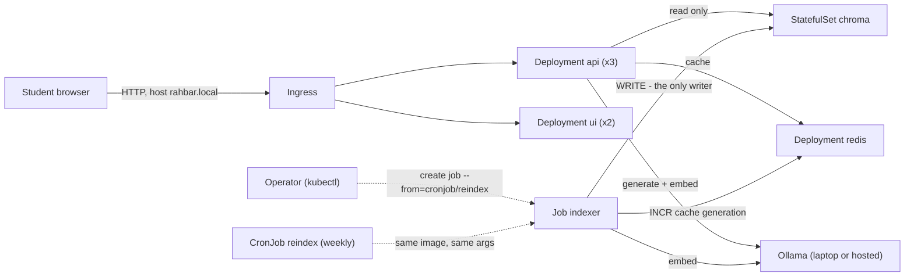
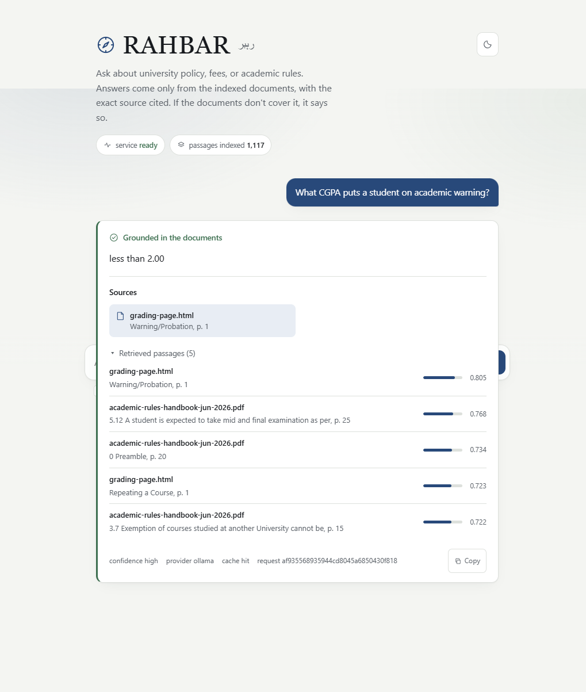

# RAHBAR


-yellow)

> The badge URLs above are placeholders until `CLAUDE.md`'s HUMAN-INPUT block
> is filled and this repo is pushed to its real GitHub remote (gate
> `G-HUMAN-01`, tracked in `harness/00_MASTER_PLAN_AND_STATUS.md` §4). Once
> pushed, replace the first badge with
> `https://github.com/<owner>/<repo>/actions/workflows/ci.yml/badge.svg`.

RAHBAR is a grounded question-answering service over a real FAST-NUCES
document corpus (academic policies, grading rules, attendance, fee
structure), deployed on Kubernetes. It never answers from what a language
model merely remembers — every answer is retrieved from an indexed corpus,
cited against the passages actually used, and the system says "I don't know"
rather than invent a clause number when the evidence isn't there. Built for
CS4032 Software Construction & Development, Assignment 02.

## Why it's built this way, in one paragraph

Two processes never share a write: an **indexer `Job`** runs once (or on a
weekly `CronJob`) and is the *only* code in the system that writes to the
vector store; three **API `Deployment`** replicas only ever read it. That
split alone prevents the single worst failure mode of a naive "index at
startup" design — three pods racing to rebuild the same Chroma collection on
every restart (`docs/adr/0001-indexer-as-job.md`, and question 1 of
`docs/ENGINEERING-NOTES.md`). Everything else in this README follows from
that one decision.

## Architecture



See `docs/ARCHITECTURE.md` for the full object inventory, the NetworkPolicy
allow matrix, the readiness state machine, and why Chroma is a
`StatefulSet` rather than a `Deployment`.

## Repository layout

```
api/          FastAPI service: retrieval, generation, caching, metrics
indexer/      the five-stage offline pipeline + the Job/CronJob entrypoint
ui/           the chat UI, served by nginx (unprivileged, read-only root)
k8s/          15 manifests under base/, dev and prod overlays via kustomize
eval/         golden.yaml (16 questions) + run_eval.py (recall@k, citations, the CI gate)
corpus/       sources.yaml, fetch.py, MANIFEST.md (corpus/raw/ is gitignored)
docs/         CORPUS.md, PIPELINE.md, FAILURE-ANALYSIS.md, ENGINEERING-NOTES.md,
              AI-USAGE.md, ARCHITECTURE.md, adr/, evidence/
scripts/      check_submission.py (never modified), evidence/*.sh capture scripts
.github/      ci.yml (lint, test, manifests, build, scan, e2e-eval),
              cd.yml (test -> build-push -> deploy)
harness/      the 29-file execution specification this build was implemented
              against (not graded; disclosed in full in docs/AI-USAGE.md)
```

## Prerequisites

WSL 2 (Ubuntu) on Windows, or a native Linux/macOS shell. Python 3.12,
Docker Desktop (WSL 2 backend), minikube, `kubectl`, `kustomize`, `git`,
`make`, and [Ollama](https://ollama.com) running on the host (listening on
all interfaces, not just `127.0.0.1`, so the cluster can reach it at
`host.minikube.internal:11434`) with `nomic-embed-text` and `llama3.2:3b`
pulled. Full versions and install commands are in `CLAUDE.md` §5 and
`harness/99_HUMAN_RUNBOOK.md` §1.

## Quick start: tests only, no cluster

```bash
make install   # creates .venv, installs api + indexer dev deps
make test      # 156 api + 58 indexer + 24 eval tests, stubs only - no network, no model
make lint      # ruff + mypy, clean
make dev       # API with stubs on http://localhost:8000, serving the chat UI
```

`make dev` runs entirely on `RETRIEVER=stub`/`LLM_PROVIDER=stub` — no
cluster, no Ollama, no corpus required to see the UI and get a cited stub
answer.

## From a clean clone to an answered question on a real cluster

Exact order; each command's target is in the `Makefile`.

```bash
# 1. Start the cluster (minikube, Calico CNI, metrics-server + ingress addons)
make cluster

# 2. Fetch the real corpus (public FAST-NUCES documents; corpus/raw/ is gitignored)
make fetch

# 3. Build the three images and load them into minikube (bakes corpus/raw/ into the indexer image)
make images

# 4. Apply every manifest via the dev kustomize overlay
#    (make apply runs exactly: kubectl apply -k k8s/overlays/dev)
make apply

# 5. Create the LLM Secret from the command line - NEVER from a committed file
export LLM_API_KEY="<your key, or any non-empty string for ollama-host>"
make secret

# 6. Run the indexer once, from the CronJob's own template
make index
kubectl get jobs -n rahbar -w        # watch it complete

# 7. Ask a question through the Ingress
#    (Windows/macOS docker-driver: run `minikube tunnel` in another terminal first,
#    then prefix the next command with INGRESS_IP=127.0.0.1)
make ask Q="What CGPA puts a student on academic warning?"

# 8. Evaluate the full golden set and enforce the recall/citation/abstention gate
make eval
```

`kubectl get all -n rahbar` at any point shows every object; `kubectl get
pods -n rahbar -w` is the fastest way to watch a rollout settle.

## Re-indexing

The indexer never runs inside the API process (see "Why it's built this way"
above). To re-index after the corpus changes:

```bash
kubectl create job --from=cronjob/reindex reindex-$(date +%s) -n rahbar
kubectl get jobs -n rahbar -w
```

The same `CronJob/reindex` also fires on its own weekly schedule with an
identical pod template — a manual re-index and the scheduled one are
provably the same code path, never two implementations to keep in sync.

## API

All endpoints live behind the Ingress `/api` path (see
`k8s/base/ingress.yaml`); `curl` examples assume the ingress is reachable at
`$INGRESS_IP` with `Host: rahbar.local`.

| Method | Path | Purpose |
| --- | --- | --- |
| POST | `/api/ask` | Ask a grounded question. Body: `{"question": "..."}`. Returns an `AskResponse`: the answer text, `answered_from_context`, `confidence`, the enforced `citations`, the raw `retrieved` passages with their metadata, and an `X-Cache: hit\|miss` response header. |
| GET | `/healthz` | Liveness. Touches nothing - never depends on Chroma, Redis or Ollama, so one slow dependency can never trigger a cluster-wide restart storm. |
| GET | `/readyz` | Readiness. Checks, in fixed order: Chroma reachable -> collection exists -> collection non-empty -> the `EMBED_MODEL` pin matches the collection's recorded model -> Redis reachable. Any failure is a `503` naming the first thing actually wrong, and the pod stays `0/1 READY` rather than serving from a broken or stale index. |
| GET | `/metrics` | Prometheus exposition: request counts/latency histograms for retrieval and generation, cache hit ratio, abstention and fallback counters, LLM token counts. |

A full request/response example, and the eight internal steps `/api/ask`
runs through (cache lookup -> retrieve -> relevance floor -> prompt -> generate
-> validate/retry/fallback -> enforce citations -> cache write), are in
`docs/ARCHITECTURE.md` and `03_LOW_LEVEL_DESIGN.md` §4.

## Documentation map

| Document | What it answers |
| --- | --- |
| `docs/CORPUS.md` | Where the documents came from, and how each of the assignment's seven required corpus properties is satisfied |
| `docs/PIPELINE.md` | Every indexing-stage decision (chunk size/overlap, embedding, storage, caching) with real measured evidence or an explicit `PENDING-HUMAN` marker where this development host lacks the infrastructure to measure it |
| `docs/FAILURE-ANALYSIS.md` | Four deliberately injected failures (extraction, retrieval, source/versioning, generation), each diagnosed as if the cause were unknown |
| `docs/ENGINEERING-NOTES.md` | Seven architecture/operations questions, each answered with a real `file:line` citation |
| `docs/ARCHITECTURE.md` | The full object inventory, the NetworkPolicy matrix, the readiness state machine, the embedding-pin mechanism |
| `docs/adr/0001..0004` | The four architecture decisions that most shape this build: indexer-as-Job, chunking strategy, cache store, LLM provider + data governance |
| `docs/AI-USAGE.md` | Full disclosure of the AI tools used to plan and build this submission, and what was changed or corrected afterwards |

## A note on honesty in this submission

Several numeric figures and cluster artifacts in `docs/` are marked
`PENDING-HUMAN(<task>)` rather than filled with a plausible-looking guess.
This development environment has no Docker daemon, no Kubernetes cluster, no
Ollama runtime and no authenticated GitHub remote; every figure that
genuinely requires one of those is left as an explicit, searchable token
naming the exact task that will produce it (see `CLAUDE.md` Law L1 and
`harness/00_MASTER_PLAN_AND_STATUS.md` §8, the Pending-Human register) rather
than fabricated. `scripts/evidence/*.sh` under `scripts/` are ready-to-run
capture scripts for exactly those steps.

<!-- screenshot: PENDING-HUMAN(P17-T08) - a clean-clone apply, then a cited
     answer in the chat UI, captured from a real cluster and saved to
     docs/evidence/ui_answer.png, to be embedded here as
      -->
