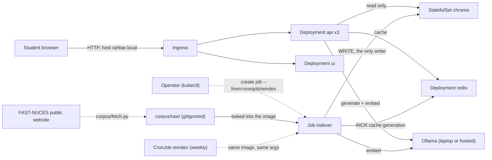
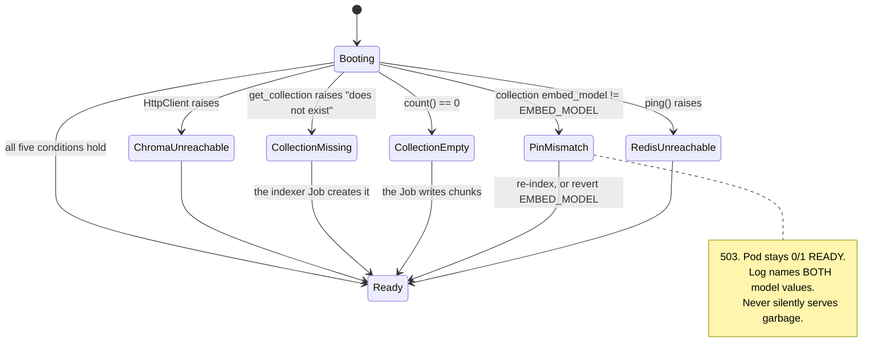

# Architecture

## System context

One sentence to hold on to: **indexing runs once, and again when the material
changes; querying runs on every question.** Every structural decision below
is that sentence taken literally on a cluster.

## Object inventory

All objects live in namespace `rahbar`, never `default`.

| Kind | Name(s) | Count | Key property |
|---|---|---|---|
| `Namespace` | `rahbar` | 1 | everything lives here |
| `Deployment` | `api` (3 replicas), `ui` (2), `redis` (1) | 3 | api has all three probes |
| `StatefulSet` | `chroma` | 1 | `volumeClaimTemplates`, 2Gi — see below |
| `Service` | `api`, `ui`, `chroma`, `redis` | 4 | **all `ClusterIP`** |
| `Ingress` | `rahbar` | 1 | one host, two paths |
| `ConfigMap` | `rahbar-config` | 1 | 21 keys |
| `Secret` | `rahbar-secret` | 1 | created by CLI; placeholder committed |
| `Job` | `indexer` | 1 | `OnFailure`, `backoffLimit: 4` |
| `CronJob` | `reindex` | 1 | weekly, identical pod template to the Job |
| `HorizontalPodAutoscaler` | `api` | 1 | `autoscaling/v2`, 3→8 |
| `NetworkPolicy` | 7 policies | 7 | deny-by-default first |
| `PersistentVolumeClaim` | `redis-data` (+ chroma's template) | 2 | neither is ephemeral |
| `ServiceAccount` | one per workload | 5 | `automountServiceAccountToken: false` on all |

## Why Chroma is a StatefulSet, not a Deployment

A `Deployment`'s `volumes` are a single shared specification across every
replica of the ReplicaSet it manages — scaling a Chroma Deployment to more
than one replica would put two independent Chroma processes writing to the
*same* underlying volume, which is the same multi-writer corruption problem
ADR 0001 rejects for the indexer, just introduced through a different object
kind. A `StatefulSet`'s `volumeClaimTemplates` bind one PVC per ordinal
(`chroma-0` gets its own, stable volume), giving the pod a stable network
identity and guaranteeing that if it is ever rescheduled, it comes back
attached to the *same* data rather than a fresh empty one. The index is
state, not a stateless computation, and state is what `StatefulSet` exists
for. This is also why `k8s/base/services.yaml`'s `chroma` Service sets
`clusterIP: None` — making it the StatefulSet's headless governing Service,
which is what gives `chroma-0.chroma.rahbar.svc.cluster.local` a meaningful,
stable DNS name, while remaining `type: ClusterIP` for the deduction the
checker cares about (never `NodePort`, never `LoadBalancer`).

## The NetworkPolicy allow matrix

Deny-by-default (`00-default-deny`, `podSelector: {}` on both directions),
then six explicit allows, plus a DNS allow that is easy to forget and whose
absence produces the most confusing symptom in the whole system: without it,
default-deny egress also blocks DNS, so `CHROMA_HOST=chroma` stops resolving
and every dependency looks broken at once, when the actual fault is "no one
can ask kube-dns anything."

| from ↓ / to → | ui:8080 | api:8000 | chroma:8000 | redis:6379 | kube-dns:53 | host Ollama:11434 |
|---|---|---|---|---|---|---|
| ingress-nginx | allow | allow | — | — | n/a | n/a |
| ui | — | allow | — | — | allow | — |
| api | — | — | allow | allow | allow | allow |
| indexer | — | — | allow | allow | allow | allow |
| chroma | — | — | — | — | allow | — |
| redis | — | — | — | — | allow | — |

The `ui` pod cannot reach `chroma` or `redis` under any path in this matrix —
`k8s/base/networkpolicy.yaml`'s `40-chroma-policy` and `50-redis-policy` each
allow ingress **only** from `app=api` and `app=indexer`, and `ui` is neither.
This is the proof obligation `scripts/evidence/P05-T08_netpol.sh` captures
directly on a live cluster with `nc`/a Python socket probe.

## The readiness state machine

`/readyz` (`api/app/routes/health.py::evaluate_readiness`) is a pure function
of five conditions, checked in a **fixed order**, so the response always
names the *first* thing that is actually wrong rather than an arbitrary one:

`/healthz` (`healthz()`, same file) is the deliberate opposite: it touches
**nothing**, unconditionally returning `{"status": "alive"}`. If liveness
depended on Chroma, one slow dependency becomes a cluster-wide restart storm —
the kubelet kills every `api` pod on a liveness failure, and if Chroma is slow
for all three replicas simultaneously, none of them ever stabilises long
enough to pass liveness again. Readiness protects users (a not-ready pod is
quietly withheld from the Service); liveness protects the pod (a not-alive
pod is restarted). Swapping their jobs — making liveness depend on Chroma —
is exactly the mistake `ENGINEERING-NOTES.md` question 2 asks about.

## The embedding pin

`EMBED_MODEL` is one ConfigMap key, read by both the indexer
(`indexer/pipeline/config.py`) and the API (`api/app/config.py`) — never two
separately-maintained values that could silently drift. The indexer writes
the model name **and the actual vector dimension** into the Chroma
collection's own metadata at store time
(`indexer/pipeline/store.py::store`), and the API compares that recorded
fact against its own configuration on every readiness probe
(`api/app/services/pin.py::check_pin`). A mismatch is not a warning log
buried somewhere — it is a 503 that keeps the pod at `0/1 READY` and names
both values in the response body and in an ERROR-level log line, making a
silently-wrong index structurally unreachable rather than merely discouraged.

## Pattern → requirement → file → test

See `harness/04_DESIGN_PATTERNS_AND_PRINCIPLES.md` §6 for the complete table.
The seams that carry real weight in this build:

| Pattern | Where | Why it was needed, not just nice |
|---|---|---|
| Strategy | `Retriever`, `LLMProvider` Protocols | the assignment's own week-1/week-2 split (stub, then real) is a ConfigMap edit because of this seam |
| Repository, split read/write | `ChromaRetriever` vs `indexer/pipeline/store.py` | the split IS the −10 defence (ADR 0001); a single class with both `.query()` and `.add()` would put a write within reach of three API replicas |
| Template Method | `BaseHTTPProvider.generate_validated` | "retry once, then fall back" is written exactly once, so it cannot be present in one provider and forgotten in another |
| Caching Proxy | `SemanticCache`, consulted in `services/answer.py` | needs mid-pipeline facts (`outcome`, citations, confidence) a literal wrapper class around the whole request could not see |
| Null Object | `StubRetriever`, `StubProvider`, `dummy.write_dummy_index` | makes CI's offline `test` job possible, and makes the §4.4 pin demonstration free (the dummy index records `dummy-768`, so flipping `EMBED_MODEL` without re-indexing reproduces the mismatch for real) |
