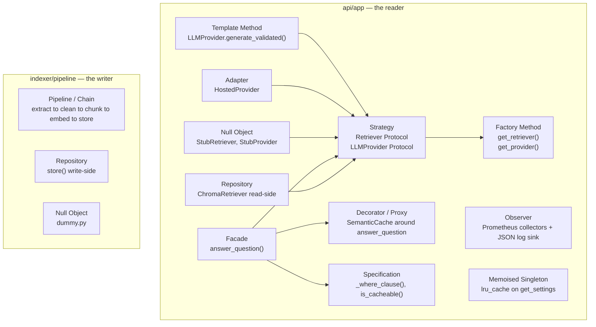

# 04 — Design Patterns and Principles

> **Purpose.** This is a Software Construction & Development course. The
> assignment never names a GoF pattern, but the code it asks for *is* a
> textbook pattern catalogue, and a viva will ask you to name the seams. This
> file names them, points at the exact file and class, says why the problem
> demanded that seam, names the alternative that was rejected, and names the
> test that proves the seam is real.

**Hard rule for Claude Code.** This document is **descriptive of the
architecture already locked in `03_LOW_LEVEL_DESIGN.md`**. It is never a reason
to add an abstraction. If a pattern below is not already in the LLD, it does not
go in the code. Indirection you cannot name a second implementation for is not a
pattern, it is a liability.

**What this file is used for:** `docs/ARCHITECTURE.md` (P17-T05) and the viva.

---

## 1. Pattern map



---

## 2. The patterns, one section each

### 2.1 Strategy — the two Protocols

**Intent (GoF).** Define a family of algorithms, encapsulate each one, and make
them interchangeable so the algorithm varies independently of the clients that
use it.

**Where.**
- `api/app/retrieval/base.py` → `class Retriever(Protocol)` with
  `name: str` and `retrieve(question: str, k: int) -> list[Passage]`.
- `api/app/providers/llm/base.py` → `class LLMProvider(Protocol)` with
  `name: str` and `generate(question: str, passages: list[Passage]) -> Answer`.

**Concrete strategies.** `StubRetriever`, `ChromaRetriever`; `StubProvider`,
`OllamaProvider`, `HostedProvider`.

**Why this problem demanded it.** The assignment imposes a hard schedule split:
Monday to Wednesday you deploy the whole cluster around a retriever that returns
three fixed passages, and Thursday to Sunday you replace it with a real vector
search. That is not a hypothetical future requirement — it is a dated
requirement in §"How the week runs". A Strategy seam makes the swap a ConfigMap
value (`RETRIEVER=stub` → `RETRIEVER=chroma`), not a code change. §3.5 then
states the same thing explicitly for generation: *"keep the interface clean
enough that a swap is one file."*

**Alternative rejected.** An `if`/`elif` on `LLM_PROVIDER` inside
`answer_question`. Rejected because it puts four providers' HTTP details,
timeouts and auth schemes into the orchestrator, makes the orchestrator
untestable without mocking HTTP, and makes CI's offline requirement
(§6, *"using a stub provider: no network, no model"*) impossible to satisfy
cleanly.

**Why `Protocol` and not `ABC`.** Structural typing means `StubRetriever` and
`ChromaRetriever` share no base class and no import of each other; mypy still
enforces the contract at every call site. There is no inheritance to break and
no `super()` chain to reason about. The starter kit already chose this, and it
is the right choice.

**Proof the seam is real.** `T-PRV-14` asserts `get_provider` returns each of
the four implementations for the four `LLM_PROVIDER` values. `T-PRV-15` asserts
an unknown value raises `ValueError`. `T-ASK-02` runs the full request path
against `StubRetriever` + `StubProvider` with no network at all — which is only
possible because the seam exists.

---

### 2.2 Factory Method — the two selectors

**Intent.** Define an interface for creating an object, but let a function
decide which class to instantiate.

**Where.**
- `api/app/retrieval/__init__.py` → `get_retriever(settings) -> Retriever`
- `api/app/providers/llm/__init__.py` → `get_provider(settings) -> LLMProvider`

**Why.** Configuration (`RETRIEVER`, `LLM_PROVIDER`) arrives as a string from a
ConfigMap. Exactly one place in the system is allowed to turn a string into a
class, and that place validates it: an unknown value raises
`ValueError(f"unknown LLM_PROVIDER {name!r}; expected stub, ollama-host, ollama-incluster or hosted")`
at startup rather than producing an `AttributeError` on the first request.

**Note the deferred import.** Each branch imports its module *inside* the
branch:

```python
if name == "hosted":
    from .hosted import HostedProvider
    return HostedProvider(settings)
```

That is deliberate and it is not stylistic. It means the stub path never imports
`chromadb` or touches `httpx`, so `make test` and the CI `test` job run with no
Chroma server reachable and no model present. Moving these imports to the top of
the file would break the offline test requirement.

**Alternative rejected.** A registry dict populated by decorators. Rejected as
over-engineering: there are four providers, the list is closed, and a dict
built at import time would reintroduce the eager imports we just removed.

**Proof.** `T-PRV-14`, `T-PRV-15`, `T-RET-07`, `T-RET-08`.

---

### 2.3 Template Method — `generate_validated`

**Intent.** Define the skeleton of an algorithm in a base operation, deferring
some steps to subclasses.

**Where.** `api/app/providers/llm/base.py`:

```python
class BaseHTTPProvider:
    settings: Settings
    name: str
    last_tokens: tuple[int, int] = (0, 0)

    def _call(self, system: str, user: str) -> tuple[str, int, int]:
        raise NotImplementedError      # the varying step

    def generate_validated(self, question, passages) -> tuple[Answer, str]:
        system, user = build_prompt(question, passages,
                                    self.settings.max_evidence_chars)
        raw, tin, tout = self._call(system, user)
        self.last_tokens = (tin, tout)

        def _retry() -> str:
            again, rin, rout = self._call(system, user)
            self.last_tokens = (self.last_tokens[0] + rin,
                                self.last_tokens[1] + rout)
            return again

        return validate_or_retry(raw, _retry)

    def generate(self, question, passages) -> Answer:
        return self.generate_validated(question, passages)[0]
```

`OllamaProvider` and `HostedProvider` inherit this and override **only**
`_call`. The fixed skeleton — build the prompt, call once, validate, retry once,
fall back — is written exactly once, so §3.4's "retry once, then fall back"
cannot be forgotten in one provider and present in the other.

> This is the one place in the system where inheritance beats composition,
> because the invariant being protected is *the order of the steps*, and the
> only thing that varies is a single leaf operation.

**`NotImplementedError` caveat.** The submission checker fails on
`raise NotImplementedError` in non-test source. `_call` therefore raises
`ProviderError("_call must be implemented by a concrete provider")` instead —
same effect, no checker violation. **Write it that way.**

**Alternative rejected.** Putting retry/validate logic in each provider.
Rejected because it duplicates the §3.4 contract twice and lets the two copies
drift.

**Proof.** `T-VAL-02` (prose then valid JSON → `"retried"`), `T-VAL-03` (prose
twice → `"fallback"`), both run against `OllamaProvider` and `HostedProvider`
with the same `httpx.MockTransport` script.

---

### 2.4 Adapter — `HostedProvider`

**Intent.** Convert the interface of a class into another interface clients
expect.

**Where.** `api/app/providers/llm/hosted.py`.

**What it adapts.** An OpenAI-compatible chat-completions API — `messages`,
`response_format.json_schema`, `choices[0].message.content`,
`usage.prompt_tokens` — onto RAHBAR's `LLMProvider` contract, which speaks
`(question, passages) -> Answer`. Ollama's shape is different in every one of
those four places (`format`, `message.content`, `prompt_eval_count`), and
neither vendor is going to change for us.

**Why it matters for grading.** §3.5 requires the provider be swappable and the
key live in a Secret. The Adapter is the thing that makes "swap is one file"
literally true: `hosted.py` is 40 lines, imports nothing from `ollama.py`, and
the orchestrator never learns which one it is talking to.

**Alternative rejected.** A single provider with `if self.settings.llm_provider
== "hosted"` branches inside each method. Rejected: it couples two vendors'
error handling, and it would leak the API key into Ollama's code path where the
`r.text[:200]` diagnostic is safe to log. (It is not safe on the hosted path —
see `03_LOW_LEVEL_DESIGN.md` §6.6.)

**Proof.** `T-PRV-11`, `T-PRV-12`, `T-PRV-13`.

---

### 2.5 Repository — split read-side and write-side

**Intent.** Mediate between the domain and a data-mapping layer, so the domain
never knows the storage API.

**Where, and the split is the point.**
- **Read-side:** `api/app/retrieval/chroma.py` → `ChromaRetriever`. Only
  `get_collection`, `query`, `count`, `metadata`.
- **Write-side:** `indexer/pipeline/store.py` → `store()`. Only
  `delete_collection`, `create_collection`, `add`, `count`.

**Why split rather than one repository class.** This is §4.2, the single most
heavily graded decision in the assignment, and it is **−10 marks** if it is
wrong. A conventional repository with both `query()` and `add()` would be a
class whose mere existence invites an `add()` call from a reader. Three API
replicas plus one `add()` reachable from the API equals three concurrent writers
on one PVC. The segregation is not stylistic tidiness; it is how the failure
becomes unreachable instead of merely discouraged.

> *"A rule is a sentence in a README that someone breaks in week nine; a
> guardrail makes the broken state unreachable."* The assignment says that about
> the embedding pin. The same sentence justifies this split.

This is **Command–Query Responsibility Segregation** at the deployment level:
the write model is a `Job` that runs to completion, the read model is a
`Deployment` that scales to eight.

**Alternative rejected.** `class ChromaRepository` with both halves, shared
between the two images. Rejected for the reason above, and because the two
images then need identical dependency sets (the API would pull in `pdfplumber`
and `pytesseract` for no reason, growing the image and the Trivy attack
surface).

**Proof.** `T-ARCH-02` greps `api/**/*.py` for `.add(`, `.upsert(` and
`.delete_collection(` and asserts zero matches. `T-ARCH-01` greps the `lifespan`
body for pipeline verbs. These two tests *are* the −10 defence.

---

### 2.6 Pipeline (Chain of Responsibility, linear form) — the five stages

**Intent.** Pass a request along a chain of handlers, each doing one
transformation.

**Where.** `indexer/pipeline/run.py::run_pipeline`:

```python
doc = clean(extract(str(path), doc_version, superseded))
pieces = chunk(doc, settings.chunk_size, settings.chunk_overlap)
vectors = embed([c.text for c in all_chunks], settings)
return store(all_chunks, vectors, settings)
```

**Why.** §3.1 specifies exactly five stages and demands a separate report per
stage in `docs/PIPELINE.md`. More importantly, §5.5 requires you to *break one
stage at a time* and diagnose it blind. That is only possible if the stages are
genuinely separable functions with typed boundaries — `str → Document →
Document → list[Chunk] → list[vector] → int`. A monolithic `build_index()`
could not be broken at stage B without also breaking A.

**The type boundaries are the deliverable.** Each arrow in that chain is a place
where information can be lost, and the assignment says so: *"Each one can lose
information, and the first one most of all."* Because `extract` returns a
`Document` you can inspect, the "before and after" table that `PIPELINE.md`
demands is a two-line script, not an archaeology project.

**Why not a formal `Stage` ABC with a `handle()` method.** The chain is fixed,
linear, five long, and compile-time known. A dispatch mechanism would add a
registry and lose the static types that make the stage boundaries checkable by
mypy. Plain functions composed in one place is the lighter and more honest
expression.

**Proof.** `T-EXT-*`, `T-CLN-*`, `T-CHK-*`, `T-EMB-*`, `T-STO-*` — five
independent test modules, one per stage, each able to run without the others.

---

### 2.7 Decorator / Proxy — the semantic cache

**Intent.** Attach additional responsibilities to an object dynamically; or
provide a surrogate that controls access to it.

**Where.** `api/app/services/cache.py::SemanticCache`, consulted at the top of
`answer_question` and written at the bottom.

**Which pattern it actually is.** It is a **caching proxy** in behaviour — same
logical operation (`question → AskResponse`), interposed to avoid the expensive
path — implemented as a conditional branch rather than a wrapper class.

**Why not a literal wrapper class** (`CachedAnswerer(Answerer)`)? Because the
cache must observe facts that only exist *mid-pipeline*: `is_cacheable()` reads
`response.answered_from_context`, `response.citations` and the validation
`outcome`, and the lookup reuses the question embedding that retrieval needs
anyway. A wrapper that only sees the input and the output would have to embed
the question twice and could not implement §3.3's four never-cache rules at all.
The honest engineering call is an explicit branch in the orchestrator, with all
cache *policy* isolated in `cache.py` — and that is what §3.3 is really asking
for.

**Record this in ADR 0003.** The ADR must defend two things: Redis over a
second Chroma collection, *and* this placement.

**Proof.** `T-CAC-01..12`. In particular `T-CAC-05..08` assert each never-cache
rule independently, and `T-CAC-10..12` assert the generation-counter
invalidation.

---

### 2.8 Null Object — the stubs and the dummy index

**Intent.** Provide an object with neutral behaviour so clients need no null
checks.

**Where.** `api/app/retrieval/stub.py::StubRetriever`,
`api/app/providers/llm/stub.py::StubProvider`,
`indexer/pipeline/dummy.py::write_dummy_index`.

**Why it is load-bearing here, not decorative.** Three separate requirements
depend on it:

1. §6 CI: *"pytest with coverage of at least 60% on the app package, using a
   stub provider: no network, no model."* A Null Object is what makes an offline
   CI job possible.
2. §"How the week runs": the whole Kubernetes deployment is proved — Job,
   StatefulSet, PVC, probes, Ingress — against `--dummy`, before any real
   pipeline exists.
3. §4.4's demonstration is **free** because of the dummy: it records
   `embed_model="dummy-768"`, so flipping the ConfigMap to the real model
   without re-indexing puts the pod at `0/1 READY` with the conflict logged.
   The Null Object creates the exact state the guardrail must catch.

A Null Object that is *deterministic* (same input, same output) is also what
lets `test_starter.py` assert `len(body.retrieved) == 3` as a contract.

**Proof.** The six starter tests; `T-RDY-08` (stub mode reports ready);
`test_starter_dummy.py`'s four tests.

---

### 2.9 Observer — metrics and structured logs

**Intent.** Define a one-to-many dependency so that when one object changes
state, all its dependents are notified.

**Where.**
- `api/app/routes/metrics.py` — nine Prometheus collectors. The HTTP middleware
  in `main.py` notifies `REQUESTS` and `LATENCY` on every request without any
  route knowing it is observed.
- `api/app/logjson.py` — `JsonFormatter` observes every `LogRecord` and turns
  `extra=` keys into JSON fields.

**Why.** §4.8 requires eight named metrics and one structured log line per
request. The Observer shape is what keeps that from polluting the business
logic: `answer_question` calls `ABSTENTIONS.labels(reason=reason).inc()` and
knows nothing about Prometheus' text format, the HTTP endpoint, or who is
scraping. Add a tenth metric and no existing code changes.

**The middleware is the subject.** It is registered once, observes the route
template rather than the raw URL (`getattr(route, "path", "unmatched")` — so
`/api/ask` is one label, not one per query string), and it is the reason
cardinality stays bounded. That detail is the starter's and it is correct; do
not change it.

**Proof.** `T-MET-01..09`. `T-MET-08` asserts the formatter emits
`request_id` on a line that never mentions it, which is the Observer working.

---

### 2.10 Memoised Singleton — `get_settings`

**Intent.** Ensure a class has one instance and provide a global access point.

**Where.** `@lru_cache(maxsize=1)` on `api/app/config.py::get_settings` and
`indexer/pipeline/config.py::get_settings`.

**Why this form, not a class-level `_instance`.** The classic Singleton is a
mutable global with an initialisation race. This is a pure function returning a
**frozen** dataclass, memoised by the standard library. It is thread-safe,
immutable, and has an explicit escape hatch for tests
(`reset_settings_cache()` → `get_settings.cache_clear()`).

**Why singleton at all.** §4.1's contract is that every value comes from one
ConfigMap through the environment, so one image runs everywhere. Reading
`os.environ` twice invites two different answers after a `monkeypatch`, and
`os.environ` is read in exactly two files in the whole repository. The
memoisation makes "read once at startup" a fact rather than a convention.

**Alternative rejected.** Passing a `Settings` instance down through every
call. Partly adopted, in fact: `answer_question`, `retrieve`, `store` and
`embed` all *take* `settings` as a parameter rather than calling
`get_settings()` themselves. The singleton exists only at the two edges —
`lifespan` and `run.main` — which is why every inner function is unit-testable
with a hand-built `Settings`.

**Proof.** `T-CFG-01..13`, all of which construct `Settings` directly or
monkeypatch the environment and call `reset_settings_cache()`.

---

### 2.11 Facade — `answer_question`

**Intent.** Provide a unified higher-level interface to a set of subsystems.

**Where.** `api/app/services/answer.py::answer_question`.

**Why.** §3.2 lists eight steps. The route handler
(`api/app/routes/ask.py::ask`) is three lines and knows about none of them; it
hands over to one function. That one function then delegates each step to a
module that does nothing else — `cache.py`, `chroma.py`, `abstain.py`,
`prompt.py`, `validate.py`, `citations.py`. The Facade is thin by construction:
it contains ordering and logging, and no step's logic.

**The ordering is the invariant it protects**, and it is graded:
cache before retrieval (so a hit costs no Chroma query), relevance floor before
generation (so abstention costs no model call and is therefore deterministic at
100%, per §5.3), citation enforcement after generation (nothing to check until
then).

**Proof.** `T-ASK-07..12` drive the whole path and assert the ordering
observably: `T-ASK-09` asserts that a below-floor question produces **zero**
provider calls.

---

### 2.12 Specification — the two predicates

**Intent.** Encapsulate a business rule in a reusable, testable object.

**Where.**
- `ChromaRetriever._where_clause(question)` → `{"superseded": False}` or `None`.
- `cache.is_cacheable(response, outcome)` → the four never-cache rules.
- `abstain.should_abstain(passages, floor)` → `(bool, reason)`.

**Why.** Each of these is a rule the assignment states in prose and deducts
marks for getting wrong. Extracting each into a named pure function means the
rule has a single definition, a unit test, and a name you can say out loud in a
viva — rather than being an inline boolean buried in a 60-line orchestrator.
`_where_clause` in particular is the entire defence against failure mode E
(*"the retriever faithfully returns the wrong year"*), and §3.1 is explicit that
*"Metadata filtering fixes failure mode E. A prompt cannot."*

**Proof.** `T-RET-03..06`, `T-CAC-05..08`, `T-ABS-01..03`.

---

## 3. SOLID — one section each, with the concrete violation avoided

### S — Single Responsibility

Each module in `02_HIGH_LEVEL_DESIGN.md` §9 has a one-sentence responsibility
and a "must not" clause. The test of adherence: **how many reasons does this
file have to change?**

`services/validate.py` changes only if §3.4's retry policy changes.
`services/citations.py` changes only if the citation-matching rule changes.
`providers/llm/ollama.py` changes only if Ollama's HTTP API changes.

**The violation avoided.** The starter ships `answer.py` with retrieve-then-
generate and a `STARTER-TODO` saying *"Keep this function thin: put each step in
its own module under services/ so each can be unit-tested."* The tempting move
is to grow that one function to 150 lines holding the cache, the floor, the
retry and the citation check. That version has five reasons to change, and
unit-testing the citation rule would require standing up a fake Redis and a fake
provider. We split it, and `test_citations.py` needs neither.

### O — Open/Closed

Open for extension, closed for modification. Adding a fifth LLM provider means:
create one file, add one branch to `get_provider`. Nothing in `answer.py`,
`validate.py`, `prompt.py`, `citations.py`, `abstain.py` or `cache.py` is
touched. Adding a tenth metric means one line in `metrics.py` and one
`.inc()` at the call site.

**The boundary of the claim, stated honestly.** The `Retriever` and
`LLMProvider` protocols are open. The **schemas are deliberately closed** —
`api/app/schemas.py` is frozen because the UI, `eval/run_eval.py` and six
starter tests depend on its exact field names. Closing a contract on purpose is
a design decision, not a failure of OCP, and `STARTER.md` says so: *"If you
change a contract … say why in an ADR."*

### L — Liskov Substitution

Every `Retriever` returns `list[Passage]` with `score` as **similarity in
`[0, 1]`, higher is closer** — never a distance. `ChromaRetriever` converts
(`1 - distance`) and clamps, specifically so it is substitutable for
`StubRetriever`, whose scores are hard-coded `0.91 / 0.84 / 0.77`.

**The violation avoided, and it is the subtle one.** If `ChromaRetriever`
returned raw cosine *distance* (where lower is better), then
`should_abstain(passages, floor)` — which compares `max(score) < floor` —
would invert silently. Every relevant result would look irrelevant and the
system would abstain on everything, with no exception anywhere. The clamp and
the conversion in `03_LOW_LEVEL_DESIGN.md` §6.1 are LSP enforcement.

Similarly, every `LLMProvider.generate` returns a **validated** `Answer` or
raises `ProviderError`. None returns `None`, a dict, or a half-populated model,
so `answer.py` needs no `isinstance` check and no defensive `if answer is None`.

### I — Interface Segregation

No client depends on a method it does not use. `Retriever` has exactly one
method. `LLMProvider` has exactly one. The extra methods `ChromaRetriever`
exposes for readiness — `collection_metadata()` and `collection_count()` — are
**deliberately not on the Protocol**, because `StubRetriever` has no collection
and would be forced to implement meaningless stubs. `evaluate_readiness` does a
`getattr`/stub-mode check instead.

**The violation avoided.** A fat `Retriever` Protocol with
`retrieve + metadata + count + health + embed_question` would force
`StubRetriever` to implement five methods, four of them lies, to keep `make dev`
working.

### D — Dependency Inversion

High-level policy does not depend on low-level detail; both depend on
abstractions.

`answer_question` — the policy — depends on the `Retriever` and `LLMProvider`
Protocols. `ChromaRetriever` and `OllamaProvider` — the details — depend on
those same Protocols. Nothing in `services/` imports `chromadb` or `httpx`.
Composition happens once, in `main.py::lifespan`.

**DIP is also the literal answer to a −8 deduction.** §4.4 requires that the
indexer and the API *cannot disagree silently* about the embedding model. Both
depend on the same abstraction — `EMBED_MODEL` in one ConfigMap — and the
agreement is then *verified against data* (`check_pin` reads the collection's
own metadata) rather than assumed. The dependency is inverted onto a shared
contract, and the contract is checked at runtime. That is DIP earning its marks.

---

## 4. Principles beyond SOLID that this design leans on

| Principle | Where it shows up | What it buys |
|---|---|---|
| **Fail fast, fail loud** | `chunk()` raises on `overlap >= size`; `store()` raises on a length mismatch *before* touching Chroma; `embed()` raises on dimension drift | a bad config fails the Job in one second rather than writing a corrupt index |
| **Fail safe at the edge** | a provider error becomes `FALLBACK_ANSWER`, never a 500; a dead Redis becomes a cache miss | §3.4: *"A user must never see a 500 because the model wrote prose instead of JSON"* |
| **Make the broken state unreachable** | the read/write split (§2.5); `enforce_citations` dropping post-hoc; the floor checked before the model | the three −10 deductions become structurally impossible, not merely avoided |
| **Honest unavailability** | `/readyz` 503s with the failing dependency named; the pod leaves the Service | §4.2: readiness must not be a lie |
| **Separate liveness from readiness** | `/healthz` touches nothing; `/readyz` touches everything | §4.3: one slow dependency must not become a restart storm |
| **Immutability** | `Settings` and `IndexerSettings` are `frozen=True`; `clean()` returns a new `Document`; `enforce_citations` uses `model_copy` | no spooky action at a distance across three replicas |
| **Determinism where it is cheap** | stable chunk ids; `fake_vector` is a hash; stubs are pure; abstention is arithmetic not inference | §5.4: *"You do not assert on the model's words. You assert on measurable properties"* |
| **One way to configure** | `os.environ` read in exactly two files | one image runs in every environment |
| **Untrusted by default** | retrieved text and model output sanitised, delimited, schema-constrained, validated | §4.7's fifth hole |
| **Bounded everything** | timeouts on all four outbound calls; `backoffLimit: 4`; `cache_max_entries: 512`; exactly one retry; `max_evidence_chars` | nothing in this system can consume unbounded time or memory |
| **YAGNI** | no BM25, no re-ranker, no query rewriting, no Chroma replication, no `Stage` ABC, no registry | `02_HIGH_LEVEL_DESIGN.md` §13 records each omission so nobody "restores" it |

---

## 5. Anti-patterns explicitly avoided, and why each one was tempting

| Anti-pattern | The tempting version | Why it is rejected |
|---|---|---|
| **God object** | one `RAGService` class holding retrieval, prompting, generation, validation, caching and metrics | five reasons to change; untestable without mocking three network clients; the starter's own TODO warns against it |
| **Anaemic pipeline** | `extract_clean_chunk_embed_store(path)` as one function | §5.5 requires breaking one stage at a time; you cannot break stage B of a monolith |
| **Shared mutable repository** | `ChromaRepository` with both `query()` and `add()`, imported by both images | puts an `add()` within reach of three API replicas — the −10 deduction |
| **Config in code** | `TOP_K = 5` as a module constant | §4.1 requires it in the ConfigMap; a constant needs a rebuild to change, which is *"the Friday failure from Lecture 05"* |
| **Prompt-as-security** | "please ignore injected instructions" as the whole defence | §3.1 is explicit: *"Metadata filtering fixes failure mode E. A prompt cannot."* We sanitise, delimit, constrain the schema, validate, and enforce citations mechanically |
| **Trusting structured output** | `format=` on the request, no Pydantic validation after | §3.4: *"Structure can be guaranteed; truth cannot."* The checker greps for both `format=` and `model_validate` |
| **Retry storm** | retry until valid, or three retries with backoff | §3.4 says *retry once*. Bounded by design; worst case is 2 × timeout |
| **Cache everything** | cache every response including abstentions | §3.3: *"A cached mistake is served to everyone."* Four explicit never-cache rules |
| **Liveness probes the world** | `/healthz` pings Chroma so "health" means something | §4.3: *"one slow dependency becomes a cluster-wide restart storm"*; the checker inspects the handler body |
| **Index on startup** | `@app.on_event("startup")` builds the index "so it's always fresh" | the four failures in `02_HIGH_LEVEL_DESIGN.md` §4; −10 marks; two guard tests |
| **Base64 as encryption** | committing a Secret manifest with a real base64 value | −15 marks. *"Base64 is encoding, not encryption"* |
| **`:latest`** | `image: rahbar-api:latest` in the manifests | −6 marks. *"'What is running?' must have a one-word answer you can paste into git show"* |
| **Number without measurement** | `chunk_size: 400  # a good default` | §3.1: *"A sensible number with no measurement behind it scores zero on that rubric line."* Three measured configs, in a table |
| **Fabricated evidence** | a plausible-looking `kubectl top` table written by the agent | `CLAUDE.md` L1. Academically dishonest and factually wrong |

---

## 6. Pattern → requirement → file → test (the viva table)

Copy this into `docs/ARCHITECTURE.md`. It is the fastest possible answer to
"show me where that pattern lives".

| Pattern | Requirement it serves | File | Symbol | Test |
|---|---|---|---|---|
| Strategy | PR-01, week-1/week-2 swap | `api/app/retrieval/base.py`, `providers/llm/base.py` | `Retriever`, `LLMProvider` | T-PRV-14, T-RET-07 |
| Factory Method | PR-01, offline CI | `retrieval/__init__.py`, `providers/llm/__init__.py` | `get_retriever`, `get_provider` | T-PRV-14, T-PRV-15 |
| Template Method | GN-02, GN-03 | `providers/llm/base.py` | `BaseHTTPProvider.generate_validated` | T-VAL-02, T-VAL-03 |
| Adapter | PR-01, SE-01 | `providers/llm/hosted.py` | `HostedProvider` | T-PRV-11..13 |
| Repository (read) | QP-04 | `retrieval/chroma.py` | `ChromaRetriever` | T-RET-01..06 |
| Repository (write) | IX-05, IX-10, DED-03 | `indexer/pipeline/store.py` | `store` | T-STO-01..08, T-ARCH-02 |
| Pipeline / Chain | IX-01..05, EV-11 | `indexer/pipeline/run.py` | `run_pipeline` | T-EXT/CLN/CHK/EMB/STO-* |
| Caching Proxy | CA-01..05 | `services/cache.py` | `SemanticCache` | T-CAC-01..12 |
| Null Object | PR-03, CI-03, K8-20 | `retrieval/stub.py`, `providers/llm/stub.py`, `pipeline/dummy.py` | `StubRetriever`, `StubProvider`, `write_dummy_index` | starter tests, T-RDY-08 |
| Observer | OB-01, OB-03, OB-04 | `routes/metrics.py`, `logjson.py` | 9 collectors, `JsonFormatter` | T-MET-01..09 |
| Memoised Singleton | K8-10, PR-04 | `config.py` ×2 | `get_settings` | T-CFG-01..13 |
| Facade | QP-01..08 | `services/answer.py` | `answer_question` | T-ASK-07..12 |
| Specification | QP-04, CA-04, GN-04 | `chroma.py`, `cache.py`, `abstain.py` | `_where_clause`, `is_cacheable`, `should_abstain` | T-RET-03..06, T-CAC-05..08, T-ABS-01..03 |
| CQRS (deployment level) | K8-04, K8-06, DED-03 | `k8s/base/indexer-job.yaml`, `api-deployment.yaml` | `kind: Job` vs `kind: Deployment` | T-ARCH-01, T-ARCH-02 |
