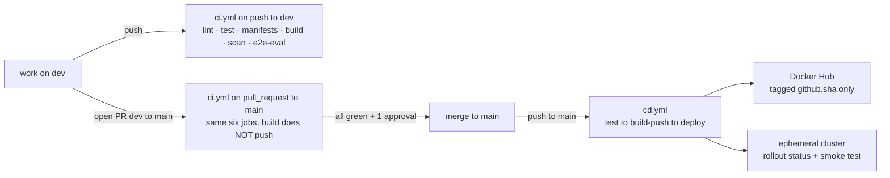

# 08 — CI/CD Workflow Specification

> Both workflows, job by job, with the complete YAML. Plus branch protection
> click-by-click, the GitHub Secrets list, and the scripted demonstration that
> the eval gate actually blocks a merge.

**Four deductions live in this file.** `needs:` missing on a publishing or
deploying job is −6. Deploying `:latest` is −6. A secret in history is −20.
Pushing straight to `main` is −4.

---

## 1. Branch model

| Branch | Role | Protection |
|---|---|---|
| `dev` | all work happens here; every commit lands here first | none |
| `main` | the deployable branch; `cd.yml` fires on push | **protected**: no direct pushes, PR required, CI required to pass, one approval required |



---

## 2. GitHub Secrets

Settings → Secrets and variables → Actions → New repository secret.

| Name | Value | Notes |
|---|---|---|
| `DOCKERHUB_USERNAME` | your Docker Hub username | not an email |
| `DOCKERHUB_TOKEN` | a Docker Hub **access token** | Account Settings → Security → New Access Token, scope *Read & Write*. **Never your password** — the assignment says so explicitly |

That is all. No `LLM_API_KEY` in CI: every CI job uses `LLM_PROVIDER=stub`, so
CI never calls a model and never needs a key. That is also why the `test` job
can run with no network.

---

## 3. Branch protection — exact settings

Settings → Branches → Add branch protection rule.

| Field | Value |
|---|---|
| Branch name pattern | `main` |
| Require a pull request before merging | ✅ |
| └ Require approvals | ✅ **1** |
| └ Dismiss stale pull request approvals when new commits are pushed | ✅ |
| Require status checks to pass before merging | ✅ |
| └ Require branches to be up to date before merging | ✅ |
| └ Required status checks | `lint`, `test`, `manifests`, `build`, `scan`, `e2e-eval` |
| Require conversation resolution before merging | ✅ |
| Do not allow bypassing the above settings | ✅ |
| Allow force pushes | ❌ |
| Allow deletions | ❌ |

> The required status checks only appear in the picker **after** `ci.yml` has run
> at least once. Sequence: commit `ci.yml` on `dev`, push, let it run, then come
> back and tick the six boxes.

**Evidence (P14-T04).** Screenshot the saved rule page showing the six required
checks and the approval count. Save as
`docs/evidence/branch_protection.png`. This is evidence file 2 of 5.

---

## 4. `.github/workflows/ci.yml`

Triggers: pull requests to `main`, and pushes to `dev`. Six jobs.

```yaml
name: ci

on:
  pull_request:
    branches: [main]
  push:
    branches: [dev]

# Least privilege: nothing in CI writes to the repository.
permissions:
  contents: read

concurrency:
  group: ci-${{ github.ref }}
  cancel-in-progress: true

env:
  PYTHON_VERSION: "3.12"

jobs:
  # ---------------------------------------------------------------- 1. lint
  lint:
    name: lint
    runs-on: ubuntu-24.04
    permissions:
      contents: read
    steps:
      - uses: actions/checkout@v4
      - uses: actions/setup-python@v5
        with:
          python-version: ${{ env.PYTHON_VERSION }}
          cache: pip
      - name: install tooling
        run: |
          python -m pip install --upgrade pip
          pip install -r api/requirements-dev.txt -r indexer/requirements-dev.txt
      - name: ruff
        run: ruff check api indexer eval corpus scripts
      - name: mypy api
        run: cd api && mypy app
      - name: mypy indexer
        run: cd indexer && mypy pipeline

  # ---------------------------------------------------------------- 2. test
  test:
    name: test
    runs-on: ubuntu-24.04
    permissions:
      contents: read
    steps:
      - uses: actions/checkout@v4
      - uses: actions/setup-python@v5
        with:
          python-version: ${{ env.PYTHON_VERSION }}
          cache: pip
      - name: install
        run: |
          python -m pip install --upgrade pip
          pip install -r api/requirements-dev.txt -r indexer/requirements-dev.txt
      # Stub provider, stub retriever: no network, no model, no cluster.
      - name: api tests with coverage
        env:
          RETRIEVER: stub
          LLM_PROVIDER: stub
          CACHE_ENABLED: "false"
        run: |
          cd api
          pytest -q --cov=app --cov-report=term-missing --cov-report=xml --cov-fail-under=60
      - name: indexer tests
        run: cd indexer && pytest -q
      - name: eval tests
        run: cd eval && pytest -q
      - name: upload coverage
        if: always()
        uses: actions/upload-artifact@v4
        with:
          name: coverage-xml
          path: api/coverage.xml
          retention-days: 7

  # ----------------------------------------------------------- 3. manifests
  manifests:
    name: manifests
    runs-on: ubuntu-24.04
    permissions:
      contents: read
    steps:
      - uses: actions/checkout@v4
      - name: install kustomize and kubeconform
        run: |
          curl -sSL "https://github.com/kubernetes-sigs/kustomize/releases/download/kustomize%2Fv5.4.3/kustomize_v5.4.3_linux_amd64.tar.gz" | tar xz
          sudo install -m 0755 kustomize /usr/local/bin/kustomize
          curl -sSL "https://github.com/yannh/kubeconform/releases/download/v0.6.7/kubeconform-linux-amd64.tar.gz" | tar xz
          sudo install -m 0755 kubeconform /usr/local/bin/kubeconform
      # A broken manifest fails here in 20 seconds instead of on the cluster.
      - name: validate the prod overlay
        run: kustomize build k8s/overlays/prod | kubeconform -strict -summary -ignore-missing-schemas
      - name: validate the dev overlay
        run: kustomize build k8s/overlays/dev  | kubeconform -strict -summary -ignore-missing-schemas
      - name: assert all eleven required kinds are present
        run: |
          KINDS=$(kustomize build k8s/overlays/prod | grep -oP '^kind: \K\w+' | sort -u)
          echo "$KINDS"
          for k in Namespace Deployment StatefulSet Service Ingress ConfigMap \
                   Job CronJob HorizontalPodAutoscaler NetworkPolicy PersistentVolumeClaim; do
            echo "$KINDS" | grep -qx "$k" || { echo "::error::missing kind $k"; exit 1; }
          done
      - name: assert no default namespace and no NodePort on the data tier
        run: |
          ! kustomize build k8s/overlays/prod | grep -q 'namespace: default'
          ! kustomize build k8s/overlays/prod | grep -qE 'type: (NodePort|LoadBalancer)'
          ! grep -rn ':latest' k8s/

  # --------------------------------------------------------------- 4. build
  build:
    name: build
    runs-on: ubuntu-24.04
    # Gated: no point building images from code that failed its tests.
    needs: [lint, test, manifests]
    permissions:
      contents: read
    steps:
      - uses: actions/checkout@v4
      - uses: docker/setup-buildx-action@v3
      # Fixture corpus into the indexer build context, as section 23 of
      # harness/07 describes.
      - name: stage the fixture corpus for the indexer image
        run: |
          mkdir -p indexer/corpus-baked
          cp eval/fixtures/*.md indexer/corpus-baked/
      - name: build api
        uses: docker/build-push-action@v6
        with:
          context: api
          push: false              # NEVER push from a pull request
          load: true
          tags: rahbar-api:ci
          cache-from: type=gha
          cache-to: type=gha,mode=max
      - name: build indexer
        uses: docker/build-push-action@v6
        with:
          context: indexer
          push: false
          load: true
          tags: rahbar-indexer:ci
          cache-from: type=gha
          cache-to: type=gha,mode=max
      - name: build ui
        uses: docker/build-push-action@v6
        with:
          context: ui
          push: false
          load: true
          tags: rahbar-ui:ci
          cache-from: type=gha
          cache-to: type=gha,mode=max
      - name: export the images for the e2e job
        run: |
          docker save rahbar-api:ci rahbar-indexer:ci rahbar-ui:ci -o /tmp/rahbar-images.tar
      - uses: actions/upload-artifact@v4
        with:
          name: rahbar-images
          path: /tmp/rahbar-images.tar
          retention-days: 1

  # ---------------------------------------------------------------- 5. scan
  scan:
    name: scan
    runs-on: ubuntu-24.04
    needs: [build]
    permissions:
      contents: read
    strategy:
      fail-fast: false
      matrix:
        image: [api, indexer, ui]
    steps:
      - uses: actions/checkout@v4
      - uses: actions/download-artifact@v4
        with:
          name: rahbar-images
          path: /tmp
      - name: load the images
        run: docker load -i /tmp/rahbar-images.tar
      # Fail on HIGH or CRITICAL findings THAT HAVE A FIX AVAILABLE.
      # --ignore-unfixed is what makes this gate actionable rather than noise.
      - name: trivy
        uses: aquasecurity/trivy-action@0.28.0
        with:
          image-ref: rahbar-${{ matrix.image }}:ci
          format: table
          exit-code: "1"
          severity: HIGH,CRITICAL
          ignore-unfixed: true
          vuln-type: os,library

  # ----------------------------------------------------------- 6. e2e-eval
  e2e-eval:
    name: e2e-eval
    runs-on: ubuntu-24.04
    needs: [build]
    permissions:
      contents: read
    timeout-minutes: 25
    steps:
      - uses: actions/checkout@v4
      - uses: actions/setup-python@v5
        with:
          python-version: ${{ env.PYTHON_VERSION }}
          cache: pip
      - name: install eval dependencies
        run: pip install httpx==0.28.1 pyyaml==6.0.2

      - uses: actions/download-artifact@v4
        with:
          name: rahbar-images
          path: /tmp
      - name: load the images
        run: docker load -i /tmp/rahbar-images.tar

      - name: install kustomize
        run: |
          curl -sSL "https://github.com/kubernetes-sigs/kustomize/releases/download/kustomize%2Fv5.4.3/kustomize_v5.4.3_linux_amd64.tar.gz" | tar xz
          sudo install -m 0755 kustomize /usr/local/bin/kustomize

      - name: create a kind cluster
        uses: helm/kind-action@v1.10.0
        with:
          cluster_name: rahbar-ci
          node_image: kindest/node:v1.30.4
          wait: 120s

      - name: load the images into kind
        run: |
          kind load docker-image rahbar-api:ci      --name rahbar-ci
          kind load docker-image rahbar-indexer:ci  --name rahbar-ci
          kind load docker-image rahbar-ui:ci       --name rahbar-ci

      # CI runs the real retriever against the fixture corpus, with the stub
      # provider: retrieval is measured for real, generation is deterministic.
      - name: apply the manifests with a CI patch
        run: |
          cd k8s/overlays/dev
          kustomize edit set image rahbar-api=rahbar-api:ci
          kustomize edit set image rahbar-indexer=rahbar-indexer:ci
          kustomize edit set image rahbar-ui=rahbar-ui:ci
          cd - >/dev/null
          kustomize build k8s/overlays/dev \
            | sed -e 's/RETRIEVER: "stub"/RETRIEVER: "chroma"/' \
                  -e 's|EMBED_MODEL: "dummy-768"|EMBED_MODEL: "ci-hash-256"|' \
                  -e 's|CORPUS_DIR: "/corpus"|CORPUS_DIR: "/corpus-baked"|' \
            | kubectl apply -f -
          # kind has no Calico and no ingress-nginx: the NetworkPolicies are
          # validated by the manifests job and are inert here.

      - name: wait for the data tier
        run: |
          kubectl rollout status statefulset/chroma -n rahbar --timeout=300s
          kubectl rollout status deployment/redis   -n rahbar --timeout=180s

      # Index the three fixture documents: enough to make recall@k meaningful
      # without a six-minute CI run.
      - name: run the indexer Job on the fixture corpus
        run: |
          kubectl create job --from=cronjob/reindex ci-index -n rahbar
          kubectl wait --for=condition=complete job/ci-index -n rahbar --timeout=600s \
            || { kubectl logs job/ci-index -n rahbar --tail=200; exit 1; }
          kubectl logs job/ci-index -n rahbar --tail=20

      - name: wait for the api rollout
        run: |
          kubectl rollout status deployment/api -n rahbar --timeout=300s
          kubectl get endpoints api -n rahbar

      - name: port-forward the api Service
        run: |
          kubectl port-forward -n rahbar svc/api 8000:8000 &
          for i in $(seq 1 30); do
            curl -sf http://localhost:8000/readyz && break || sleep 2
          done
          curl -s http://localhost:8000/readyz

      # The gate. Exit 0 pass, 1 gate failed, 2 not implemented.
      - name: run the eval gate on the fixture golden set
        run: |
          python eval/run_eval.py \
            --api http://localhost:8000 \
            --golden eval/fixtures/golden.fixture.yaml \
            --baseline eval/baseline.fixture.json \
            --out /tmp/ci-results.json
      - name: show the results
        if: always()
        run: cat /tmp/ci-results.json || true
      - uses: actions/upload-artifact@v4
        if: always()
        with:
          name: ci-eval-results
          path: /tmp/ci-results.json
          retention-days: 7
      - name: diagnostics on failure
        if: failure()
        run: |
          kubectl get pods -n rahbar -o wide
          kubectl describe pods -n rahbar | tail -120
          kubectl logs -n rahbar -l app=api --tail=200 --all-containers || true
```

### Notes on `e2e-eval`

**`EMBED_MODEL: "ci-hash-256"`.** CI has no Ollama. The indexer's `embed()`
honours one extra contract: when `EMBED_MODEL` starts with `ci-hash-`, it
produces deterministic hash vectors of the dimension named in the suffix instead
of calling Ollama, using the same algorithm as `dummy.fake_vector`. The API's
`_embed_question` honours the same rule. That keeps the pin consistent (so
`/readyz` passes), exercises **real** Chroma writes, **real** vector search and
**real** `where` filtering, and needs no model. Document this in
`docs/PIPELINE.md` under "Evaluation method" — it is an honest CI affordance,
not a measurement shortcut: the real recall numbers in `baseline.json` come
from P15 against the real corpus and the real embedding model.

**`eval/baseline.fixture.json`** is a separate, committed baseline for the six
fixture questions. The real `eval/baseline.json` is for the real corpus. Mixing
them would make the CI gate compare numbers from two different corpora.

**No Calico, no Ingress in kind.** The NetworkPolicies still apply cleanly (the
manifests job proves they are valid) but kind's default CNI ignores them, and
the eval talks to the Service through `kubectl port-forward` rather than an
Ingress. The Ingress path is smoke-tested in `cd.yml` instead.

---

## 5. `.github/workflows/cd.yml`

Triggers on pushes to `main` — which, with branch protection, only happens via
a merged pull request. Three jobs in a strict `needs:` chain.

```yaml
name: cd

on:
  push:
    branches: [main]

permissions:
  contents: read

concurrency:
  group: cd-main
  cancel-in-progress: false

env:
  PYTHON_VERSION: "3.12"
  REGISTRY: docker.io

jobs:
  # ----------------------------------------------------------------- test
  test:
    name: test
    runs-on: ubuntu-24.04
    permissions:
      contents: read
    steps:
      - uses: actions/checkout@v4
      - uses: actions/setup-python@v5
        with:
          python-version: ${{ env.PYTHON_VERSION }}
          cache: pip
      - run: |
          python -m pip install --upgrade pip
          pip install -r api/requirements-dev.txt -r indexer/requirements-dev.txt
      - name: api tests with coverage
        env:
          RETRIEVER: stub
          LLM_PROVIDER: stub
          CACHE_ENABLED: "false"
        run: cd api && pytest -q --cov=app --cov-fail-under=60
      - run: cd indexer && pytest -q
      - run: cd eval && pytest -q

  # ----------------------------------------------------------- build-push
  build-push:
    name: build-push
    runs-on: ubuntu-24.04
    # WITHOUT THIS LINE YOU PUBLISH IMAGES BUILT FROM CODE YOU ALREADY KNOW IS
    # BROKEN. That is -6 marks.
    needs: [test]
    permissions:
      contents: read
    outputs:
      sha: ${{ github.sha }}
    steps:
      - uses: actions/checkout@v4
      - uses: docker/setup-buildx-action@v3
      - name: stage the fixture corpus for the indexer image
        run: |
          mkdir -p indexer/corpus-baked
          cp eval/fixtures/*.md indexer/corpus-baked/
      # A Docker Hub ACCESS TOKEN from GitHub Secrets. Never a password.
      - uses: docker/login-action@v3
        with:
          registry: ${{ env.REGISTRY }}
          username: ${{ secrets.DOCKERHUB_USERNAME }}
          password: ${{ secrets.DOCKERHUB_TOKEN }}
      # Tagged by commit SHA only. Never :latest (-6). "What is running?" must
      # have a one-word answer you can paste into git show.
      - name: push api
        uses: docker/build-push-action@v6
        with:
          context: api
          push: true
          tags: ${{ secrets.DOCKERHUB_USERNAME }}/rahbar-api:${{ github.sha }}
          cache-from: type=gha
          cache-to: type=gha,mode=max
      - name: push indexer
        uses: docker/build-push-action@v6
        with:
          context: indexer
          push: true
          tags: ${{ secrets.DOCKERHUB_USERNAME }}/rahbar-indexer:${{ github.sha }}
          cache-from: type=gha
          cache-to: type=gha,mode=max
      - name: push ui
        uses: docker/build-push-action@v6
        with:
          context: ui
          push: true
          tags: ${{ secrets.DOCKERHUB_USERNAME }}/rahbar-ui:${{ github.sha }}
          cache-from: type=gha
          cache-to: type=gha,mode=max
      - name: record the published tags
        run: |
          echo "### Published images" >> $GITHUB_STEP_SUMMARY
          for i in api indexer ui; do
            echo "- \`${{ secrets.DOCKERHUB_USERNAME }}/rahbar-$i:${{ github.sha }}\`" >> $GITHUB_STEP_SUMMARY
          done

  # --------------------------------------------------------------- deploy
  deploy:
    name: deploy
    runs-on: ubuntu-24.04
    # Deploy only what was actually published.
    needs: [build-push]
    permissions:
      contents: read
    timeout-minutes: 25
    steps:
      - uses: actions/checkout@v4
      - name: install kustomize
        run: |
          curl -sSL "https://github.com/kubernetes-sigs/kustomize/releases/download/kustomize%2Fv5.4.3/kustomize_v5.4.3_linux_amd64.tar.gz" | tar xz
          sudo install -m 0755 kustomize /usr/local/bin/kustomize

      - name: create an ephemeral cluster with an ingress controller
        uses: helm/kind-action@v1.10.0
        with:
          cluster_name: rahbar-cd
          node_image: kindest/node:v1.30.4
          config: .github/kind-ingress.yaml
          wait: 120s

      - name: install ingress-nginx
        run: |
          kubectl apply -f https://raw.githubusercontent.com/kubernetes/ingress-nginx/controller-v1.11.2/deploy/static/provider/kind/deploy.yaml
          kubectl wait --namespace ingress-nginx --for=condition=ready pod \
            --selector=app.kubernetes.io/component=controller --timeout=300s

      # Pin the prod overlay to this exact commit. Never :latest.
      - name: set the image tags to this commit SHA
        run: |
          cd k8s/overlays/prod
          kustomize edit set image rahbar-api=${{ secrets.DOCKERHUB_USERNAME }}/rahbar-api:${{ github.sha }}
          kustomize edit set image rahbar-indexer=${{ secrets.DOCKERHUB_USERNAME }}/rahbar-indexer:${{ github.sha }}
          kustomize edit set image rahbar-ui=${{ secrets.DOCKERHUB_USERNAME }}/rahbar-ui:${{ github.sha }}

      - name: apply
        run: |
          kustomize build k8s/overlays/prod \
            | sed -e 's/LLM_PROVIDER: "ollama-host"/LLM_PROVIDER: "stub"/' \
                  -e 's|EMBED_MODEL: "nomic-embed-text"|EMBED_MODEL: "ci-hash-256"|' \
                  -e 's|CORPUS_DIR: "/corpus"|CORPUS_DIR: "/corpus-baked"|' \
            | kubectl apply -f -

      - name: wait for the data tier
        run: |
          kubectl rollout status statefulset/chroma -n rahbar --timeout=300s
          kubectl rollout status deployment/redis   -n rahbar --timeout=180s

      - name: index
        run: |
          kubectl create job --from=cronjob/reindex cd-index -n rahbar
          kubectl wait --for=condition=complete job/cd-index -n rahbar --timeout=600s \
            || { kubectl logs job/cd-index -n rahbar --tail=200; exit 1; }

      # The deploy WAITS. Without rollout status it reports success before the
      # pods are serving.
      - name: rollout status
        run: |
          kubectl rollout status deployment/api -n rahbar --timeout=300s
          kubectl rollout status deployment/ui  -n rahbar --timeout=300s
          kubectl get endpoints api -n rahbar

      # Smoke test THROUGH THE INGRESS, with the Host header the rule names.
      - name: smoke test through the Ingress
        run: |
          kubectl port-forward -n ingress-nginx svc/ingress-nginx-controller 8080:80 &
          sleep 5
          for i in $(seq 1 30); do
            code=$(curl -s -o /dev/null -w '%{http_code}' -H 'Host: rahbar.local' http://localhost:8080/)
            [ "$code" = "200" ] && break || sleep 3
          done
          echo "ui: $code"; [ "$code" = "200" ]

          body=$(curl -s -X POST -H 'Host: rahbar.local' -H 'Content-Type: application/json' \
            -d '{"question":"When is a student placed on academic warning?"}' \
            http://localhost:8080/api/ask)
          echo "$body"
          echo "$body" | python3 -c "import json,sys; r=json.load(sys.stdin); assert r['retrieved'], 'nothing retrieved'; assert 'request_id' in r; print('smoke ok, provider =', r['provider'])"

      - name: deployment summary
        run: |
          echo "### Deployed" >> $GITHUB_STEP_SUMMARY
          echo "Commit: \`${{ github.sha }}\`" >> $GITHUB_STEP_SUMMARY
          kubectl get deploy,sts,job -n rahbar >> $GITHUB_STEP_SUMMARY

      - name: diagnostics on failure
        if: failure()
        run: |
          kubectl get pods -n rahbar -o wide
          kubectl describe pods -n rahbar | tail -150
          kubectl logs -n rahbar -l app=api --tail=200 --all-containers || true
```

`.github/kind-ingress.yaml` — the cluster config that lets ingress-nginx bind:

```yaml
kind: Cluster
apiVersion: kind.x-k8s.io/v1alpha4
nodes:
  - role: control-plane
    kubeadmConfigPatches:
      - |
        kind: InitConfiguration
        nodeRegistration:
          kubeletExtraArgs:
            node-labels: "ingress-ready=true"
    extraPortMappings:
      - containerPort: 80
        hostPort: 80
        protocol: TCP
      - containerPort: 443
        hostPort: 443
        protocol: TCP
```

---

## 6. The `needs:` graph, which is a graded artefact

```
ci.yml                        cd.yml
  lint ─┐                       test
  test ─┼─> build ─┬─> scan       │
  manifests ┘      └─> e2e-eval   └─> build-push ──> deploy
```

**Why each edge exists:**

| Edge | Reason |
|---|---|
| `build needs [lint, test, manifests]` | no point building an image from code that fails its own tests or ships a broken manifest |
| `scan needs [build]` | there is no image to scan until one is built |
| `e2e-eval needs [build]` | the kind cluster loads the images the build produced |
| `build-push needs [test]` | **−6 without it.** Publishing an image from known-broken code puts a bad artefact in a registry where someone will deploy it |
| `deploy needs [build-push]` | you can only deploy a tag that exists |

Verify mechanically — this is the exact check the submission checker runs:

```bash
python3 - <<'PY'
import re, pathlib
bad = []
for f in pathlib.Path(".github/workflows").glob("*.y*ml"):
    for block in re.split(r"^  (?=[A-Za-z][\w-]*:\s*$)", f.read_text(), flags=re.M):
        if re.search(r"build-push-action|docker\s+push|push:\s*true|kubectl\s+apply", block) \
           and not re.search(r"^\s{4}needs\s*:", block, re.M):
            bad.append((f.name, block.strip().split(":")[0][:40]))
print("FAIL", bad) if bad else print("ok: every publishing/deploying job is gated")
PY
```

> The regex requires `needs:` at **exactly four spaces** of indentation, i.e.
> directly under the job key. `needs:` nested anywhere else does not count.

---

## 7. Demonstrating the gate works (CI-12) — the exact sequence

The assignment requires a screenshot of the greyed-out merge button, then a
green one. Do it deliberately, not by accident.

```bash
git checkout dev && git pull
git checkout -b demo/eval-gate-fails

# Break retrieval in a way the gate must catch: top_k of 1 collapses recall@5.
sed -i 's/TOP_K: "5"/TOP_K: "1"/' k8s/base/configmap.yaml

git commit -am "ci(demo): set TOP_K to 1 to prove the eval gate blocks a merge

Phase: P14 · Task: P14-T05
Requirements: CI-12
Tests: e2e-eval
Verification: expecting the e2e-eval job to fail the recall@5 gate

Co-Authored-By: ...
Co-Authored-By: ..."
git push -u origin demo/eval-gate-fails
gh pr create --base main --head demo/eval-gate-fails \
  --title "demo: prove the eval gate blocks a merge" \
  --body "Deliberate failure to evidence requirement CI-12. Not for merge."
```

Wait for `e2e-eval` to go red.

**Screenshot 1** → `docs/evidence/blocked_merge.png`. The frame must show:
the red `e2e-eval` check, the text *"Required statuses must pass before
merging"*, and the **disabled** merge button. This is evidence file 3 of 5.

Then fix it in the same PR:

```bash
sed -i 's/TOP_K: "1"/TOP_K: "5"/' k8s/base/configmap.yaml
git commit -am "fix(ci): restore TOP_K to 5 after the gate demonstration

Phase: P14 · Task: P14-T05
Requirements: CI-12
Tests: e2e-eval
Verification: e2e-eval expected green

Co-Authored-By: ...
Co-Authored-By: ..."
git push
```

**Screenshot 2** → `docs/evidence/merge_allowed.png`: six green checks and an
enabled merge button. Then **close the PR without merging** (it was a
demonstration) and note that in `docs/FAILURE-ANALYSIS.md` or the PR body so
nobody mistakes it for abandoned work.

---

## 8. Common CI failures and their causes

| Symptom | Cause | Fix |
|---|---|---|
| `e2e-eval` exits **2** | `run_eval.py` still raises `NotImplementedError` | Phase 13 is incomplete; the four functions must be written first |
| `e2e-eval` exits **1** with an abstention message | the fixture golden set's must-abstain question was answered | the relevance floor is too low for the fixture corpus, or `where` filtering is off |
| api pod stuck `0/1 READY` in CI | `/readyz` 503 | read the body: `collection` means the Job did not write; `embed_model` means the `ci-hash-256` sed did not apply to both the ConfigMap and the indexer |
| `kubectl wait job` times out | the indexer crashed | the job's `kubectl logs` line already runs on failure — read it; usually `CORPUS_DIR` pointing at an empty directory |
| Trivy fails on the `python:3.12-slim` base | a newly disclosed CVE with a fix | rebuild (the base moves), or bump the base's patch tag. **Never** add `exit-code: "0"` |
| `docker/login-action` fails | `DOCKERHUB_TOKEN` is a password, or expired | create a fresh access token |
| `manifests` fails on an unknown kind | a CRD kubeconform has no schema for | `-ignore-missing-schemas` is already set; if it persists the manifest has a typo in `apiVersion` |
| coverage below 60% | too little tested | write the missing tests from `05_TDD_AND_TESTING_HARNESS.md`. **Never** lower `--cov-fail-under` |
| `e2e-eval` cannot pull `kindest/node` | rate limit | re-run; the tag is pinned so the cache usually holds |

---

## 9. Pinning policy

Every `uses:` is pinned to a tag the checker recognises (`@v4`, `@v3`,
`@0.28.0`, `@v1.10.0`). Every downloaded binary names an exact version in its
URL. Every container image names an exact tag.

| Action / tool | Pinned version |
|---|---|
| `actions/checkout` | `@v4` |
| `actions/setup-python` | `@v5` |
| `actions/upload-artifact` / `download-artifact` | `@v4` |
| `docker/setup-buildx-action` | `@v3` |
| `docker/login-action` | `@v3` |
| `docker/build-push-action` | `@v6` |
| `aquasecurity/trivy-action` | `@0.28.0` |
| `helm/kind-action` | `@v1.10.0` |
| kustomize | `v5.4.3` |
| kubeconform | `v0.6.7` |
| kind node image | `kindest/node:v1.30.4` |
| ingress-nginx | `controller-v1.11.2` |
| runner | `ubuntu-24.04`, never `ubuntu-latest` |

`ubuntu-latest` would be a silent version drift of exactly the kind Lecture 04
warns about, and it is the same mistake as `:latest` on an image.
