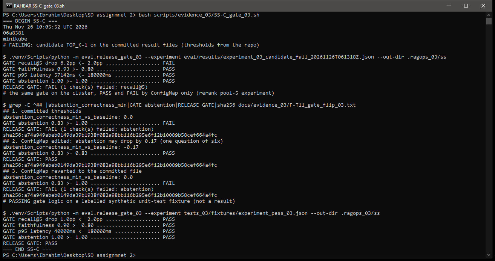
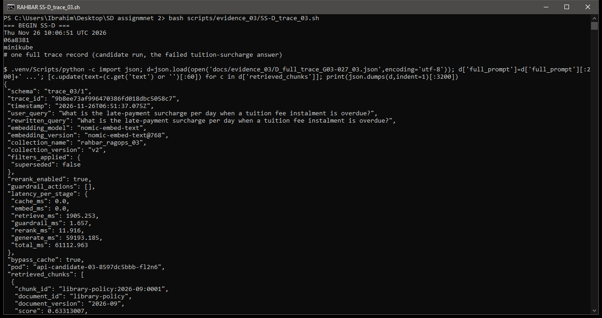

# RAHBAR - Assignment 03 (RAGOps) - Report

**CS4032 Software Construction & Development, FAST-NUCES. Assignment 03: RAGOps on RAHBAR.**

| Member | Roll number |
|---|---|
| Ibrahim Ahmed | PENDING-HUMAN(P00-T02) |
| Talha Sami | PENDING-HUMAN(P00-T02) |

Repository: https://github.com/ibrahimshaykh/rahbar (branch `dev`; `main` only through pull request).

**Summary.** RAHBAR (Assignment 02) answers questions over a document corpus with enforced citations and abstention.
Assignment 03 wraps it with RAGOps layers: a verification gate and quarantine, incremental versioned ingest with rollback,
three-level offline evaluation, an experiment and release gate, JSONL traces with metrics and guardrails, drift and
query-coverage checks, and a Kubernetes deployment with Jobs, a CronJob, a ConfigMap-driven gate and a controlled
release. No Assignment 02 file was modified; every new file ends in `_03` (design: `docs/PIPELINE_03.md`).
Results below are copied from files produced by our own runs; a cell reading `PENDING-HUMAN(<id>)` has no run yet.

## 1. Figure 3 stages mapped to this pipeline (G.1)

<!-- src: docs/PIPELINE_03.md -->
| Stage (Figure 3) | What the pipeline does | File that does it | What is missing |
|---|---|---|---|
| Ingest | Reads Batch A (A02 corpus) and Batch B (`corpus/batch_b_03/`) into a staging lake, extracting text with the A02 extractor | `indexer/run_ingest_03.py`, `indexer/pipeline/extract.py` | No connector that pulls new documents automatically; new files arrive by `kubectl cp` into `/data/incoming` |
| Verify | Four checks per document (quality, completeness, recency, uniqueness); rejects move to `quarantine/` with a reason code | `indexer/pipeline/verify_03.py` | Near-duplicate detection is embedding-similarity only; no semantic contradiction check between documents |
| Update data lake | Accepted sources are kept in `lake/`; superseded versions are copied to `archive/<doc_id>/<version>/` with `meta_03.json` | `indexer/pipeline/incremental_store_03.py`, `indexer/pipeline/state_03.py` | No retention policy: `archive/` grows until a human prunes it |
| Update retrieval sources | Plans add/replace/supersede/delete per document by chunk hash, embeds only changed chunks, versions the collection, supports delete (orphan report) and rollback | `indexer/run_ingest_03.py`, `indexer/delete_doc_03.py`, `indexer/rollback_03.py` | Single Chroma collection per release; no online (zero-downtime) re-embedding when the embedding model changes |
| Offline testing | Module, component and end-to-end suites on a golden set with two seeded runs, a change experiment and a release gate | `eval/run_suite_03.py`, `eval/change_experiment_03.py`, `eval/release_gate_03.py` | Golden set is small and partly synthetic; the faithfulness judge is a local LLM |
| Live testing | One trace per request (stdout and PVC), metrics summary, injection guardrail, candidate API and rolling release with `rollout undo` | `api/app_03.py`, `api/trace_logger_03.py`, `api/guardrail_03.py`, `eval/trace_metrics_summary_03.py`, `k8s/api_candidate_03.yaml` | No real users: live queries are simulated by the authors; no online A/B traffic split |
| Check coverage | Compares live queries with the golden set by embedding similarity, reports uncovered clusters, adds golden questions | `eval/drift_coverage_03.py` | Coverage uses the same embedding model as retrieval, so a shift that fools the model also hides the gap |

## 2. Table 2 qualities (G.2)

<!-- src: config/gate_thresholds_03.yaml -->
| Quality | What we measure | Our threshold | Evidence |
|---|---|---|---|
| Adaptability | Chunks re-embedded on an unchanged re-ingest; a version change touching only its own chunks; rollback restores the old version | `embedded_chunks=0` on an unchanged re-run; rollback restores the requested version | `docs/evidence_03/F-T10_jobs_03.txt` PENDING-HUMAN(F-T10) |
| Monitorability | Five metrics from traces over a time window (latency per stage, abstention rate, cache hit rate, guardrail actions, error rate) | gate: `max_p95_latency_ms: 100000` | `eval/trace_metrics_summary_03.py` output PENDING-HUMAN(D-T07) |
| Observability | Every request writes one JSON line to stdout and to `/data/traces/traces_03.jsonl`; `/metrics` reachable by port-forward | one trace line per response | `docs/evidence_03/SS-D_trace_03.txt` PENDING-HUMAN(SS-D) |
| Traceability | A trace id rebuilds the retrieved chunks, the full prompt, collection name/version and embedding version | trace completeness: every required field present | `api/trace_tool_03.py` output PENDING-HUMAN(D-T07) |
| Reliability | PVC survives pod restarts; one writer (Job plus lock); abstention below the relevance floor; `rollout undo` restores the previous release | trace file line count never decreases after an API pod restart; `RELEVANCE_FLOOR=0.55` | `docs/evidence_03/F-T09_pvc_03.txt`, `docs/evidence_03/F-T12_canary_03.txt` PENDING-HUMAN(F-T09, F-T12) |

## 3. Part A - data management

<!-- src: corpus/MANIFEST_batch_b_03.md -->
Batch B verification matrix (per document x quality / completeness / recency / uniqueness, with reason codes) and totals:
PENDING-HUMAN(A1-T10).

A2 lifecycle (unchanged re-run `embedded_chunks`, replace counts added/deleted/kept, delete `orphans`, supersede to archive,
rollback to version X): PENDING-HUMAN(A2-T08).

## 4. Part B - offline evaluation

<!-- pending-src: eval/results/summary_03_<ts>.md -->
Golden set composition (answerable / unanswerable / hard; human / synthetic / reviewed): PENDING-HUMAN(B-T01).
Three-level results, both runs and absolute difference: PENDING-HUMAN(B-T10).
Noise-test deltas and judge-versus-human agreement: PENDING-HUMAN(B-T10).
Why latency and faithfulness vary between runs while retrieval metrics do not: PENDING-HUMAN(B-T10).

## 5. Part C - experiment and release gate

<!-- src: config/gate_thresholds_03.yaml -->
| Gate rule | Threshold | Rationale |
|---|---|---|
| Recall@5 may drop by at most | 2.0 percentage points vs baseline | one golden question must not decide a release |
| Faithfulness at least | 0.80 | pre-calibration default; recalibrated after Part B |
| p95 latency at most | 100000 ms | below the 120 s Ingress read timeout |
| Abstention correctness vs baseline | candidate >= baseline + 0.0 | abstention must not regress |

Experiment table (3 levels x baseline / candidate_fail / candidate_pass) and release decision:
PENDING-HUMAN(C-T04). Candidate presets: `config/candidate_fail_03.env`, `config/candidate_pass_03.env`.

## 6. Part D - traces, metrics, guardrails

Abridged real trace record (at most 20 lines): PENDING-HUMAN(D-T07). Five-metric table: PENDING-HUMAN(D-T07).
Guardrail log for the injected Batch B document: PENDING-HUMAN(D-T07). Five-line root-cause analysis of one failed
answer, from one trace only: PENDING-HUMAN(D-T08).

## 7. Part E - drift and query coverage

Coverage before and after versus the 85 % threshold, clusters, number of new golden questions with one example, data
drift deltas: PENDING-HUMAN(E-T05). Live queries are written by the authors, not collected from users (`docs/PIPELINE_03.md`).

## 8. Part F - Kubernetes

<!-- src: k8s/README_03.md -->
Manifests (all namespace `rahbar`, ClusterIP only): `k8s/pvc_03.yaml`, `k8s/serviceaccount_03.yaml`,
`k8s/networkpolicy_03.yaml`, `k8s/gate_configmap_03.yaml`, `k8s/ingest_job_03.yaml`, `k8s/ingest_cronjob_03.yaml`,
`k8s/eval_job_03.yaml`, `k8s/api_candidate_03.yaml`, `k8s/config_candidate_03.yaml`, `k8s/patch_api_rollout_03.yaml`,
`k8s/helper_pod_03.yaml`; image `Dockerfile_03`. Static checks: `tests_03/k8s/test_manifests_03.py`.

Resources (requests/limits copied from `kubectl top` measurements): PENDING-HUMAN(F-T07).
PVC persistence across pod restarts: PENDING-HUMAN(F-T09). Ingest Job, idempotent re-run, CronJob: PENDING-HUMAN(F-T10).
Gate flip by ConfigMap only (verdict PASS to FAIL to PASS, same image id): PENDING-HUMAN(F-T11).
Canary, bad release, `rollout undo` and revision map (R1 A02 manifest, R2 A03 app, R3 promoted candidate, R4 bad release,
undo returns the R3 spec as R5), with the post-undo trace: PENDING-HUMAN(F-T12).

## 9. Short answers (G.4)

**4(a) Which verification check caught the most problems in Batch B, and which problem did you not catch? What would catch it?**
The four checks are quality, completeness, recency and uniqueness (`indexer/pipeline/verify_03.py`); the planted defects
and expected reason codes are listed in `corpus/MANIFEST_batch_b_03.md`. Which check fired most, and which defect slipped
through: PENDING-HUMAN(A1-T10).

**4(b) Give an example from your results where a module-level metric looked fine but a component or end-to-end metric did not, or explain why you did not see one.**
PENDING-HUMAN(B-T10) (needs the three-level suite output).

**4(c) Did you archive or delete old versions, and what breaks if you delete?**
We archive: a superseded version source is copied to `archive/<doc_id>/<version>/` with `meta_03.json`, and its chunks are
deactivated (`is_active=False`, `superseded=True`), not deleted (`indexer/pipeline/incremental_store_03.py`). Deleting the
archive copy breaks rollback once the chunks are pruned, because `indexer/rollback_03.py` re-embeds from the archived file.
`delete_doc_03` removes the chunks of a document and archives its source; the orphan report must then show `orphans=0`.
Measured outcome: PENDING-HUMAN(A2-T08).

**4(d) Which metric in your suite do you trust least, and why?**
Candidate: the LLM-judged faithfulness, because the judge is a local model; its agreement with our human labels is the
number that decides how far to trust it: PENDING-HUMAN(B-T10).

**4(e) Which of the paper's ideas was hardest to apply to your pipeline, and what did you change from the paper?**
Draft for the partners to rewrite: the Assignment 02 API and indexer are existing code, so lifecycle stages such as live
testing had to be added by wrapping them (proxies around the retriever and provider, `api/tracing_proxies_03.py`) rather
than by redesigning the pipeline. What we changed from the paper, with evidence: PENDING-HUMAN(G-T04).

**4(f) Which Kubernetes object carries which RAGOps responsibility in your design (e.g. which object makes sure only one component writes to the vector store)?**
Job `ragops-ingest-03` is the only writer to Chroma (`completions: 1`, no parallelism, plus a lock file on the PVC); CronJob
`ragops-ingest-cron-03` re-ingests weekly with `concurrencyPolicy: Forbid`; PVC `rahbar-ragops-pvc-03` keeps lake, archive,
state, results and traces across restarts; ConfigMap `rahbar-gate-03` holds the gate thresholds so the verdict changes
without an image rebuild; Deployment `api-candidate-03` plus the live Deployment `maxUnavailable: 0` rolling update and
`kubectl rollout undo` carry controlled release; NetworkPolicy `74-allow-ragops-to-chroma-03` lets only the ingest, candidate
and eval pods reach Chroma in addition to the A02 allow rules, and `ui` still cannot. Limit: the API is allowed to reach
Chroma by the A02 policy, so "read only" is enforced by its code, not by the network.

## 10. Contribution and AI disclosure

<!-- src: CLAUDE_03.md -->
| Member | Parts owned (self-reported by the partners) | Commits (`git shortlog -sne`) |
|---|---|---|
| Ibrahim Ahmed | PENDING-HUMAN(G-T05) | PENDING-HUMAN(G-T05) |
| Talha Sami | PENDING-HUMAN(G-T05) | PENDING-HUMAN(G-T05) |

AI disclosure: Claude Code (Anthropic) was used to draft the harness, code, tests and report text under our direction; we
ran all cluster commands, took the screenshots, wrote the golden questions and the human faithfulness labels, and reviewed
all results. Numbers in this report come from files produced by our runs. (Partners: edit only to keep this true.)

Limitations: queries for Part E are simulated; the embedding and judge models run on a laptop CPU; the evaluation set is small.

## Appendix (does not count toward the 8 pages)

Each screenshot is uncropped and shows the `=== BEGIN SS-X ===` and `=== END SS-X ===` banners.

**A** - `bash scripts/evidence_03/SS-A_data_lifecycle_03.sh`: Batch B verification report, second unchanged ingest (0 chunks), delete and orphan report, rollback.

**B** - `bash scripts/evidence_03/SS-B_suite_03.sh`: the three-level evaluation summary with both runs and the results on the PVC.

**C** - `bash scripts/evidence_03/SS-C_gate_03.sh`: gate FAIL for the failing candidate and PASS for the passing one.

**D** - `bash scripts/evidence_03/SS-D_trace_03.sh`: one full trace record and the trace tool rebuilding context and prompt.

**E** - `bash scripts/evidence_03/SS-E_drift_03.sh`: query coverage before and after expansion.

**F** - `bash scripts/evidence_03/SS-F_cluster_03.sh`: cluster objects, rollout history, `rollout undo` and the trace afterwards, `kubectl top pods`.
